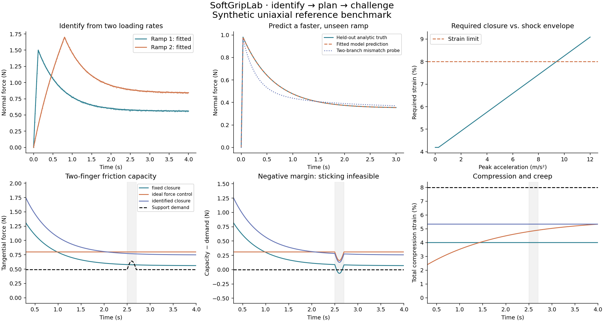
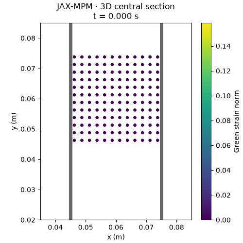

# SoftGripLab

**Material identification, compliant grasp planning, and shock-response benchmarks.**

SoftGripLab connects contact-mechanics measurements to decisions about how tightly
a robot should grasp a soft object. It builds on SciPy and
[JAX-MPM](https://github.com/lililii124/jax-mpm); it does not implement another
particle solver, optimizer, robot simulator, or visualization file format.

[中文说明](README.zh-CN.md) · [Model assumptions](docs/MODELS.md) ·
[Validation](docs/VALIDATION.md) · [Development roadmap](docs/ROADMAP.md)



## What works in v0.1

| Component | Implementation | Evidence |
| --- | --- | --- |
| Material identification | Standard linear solid, joint fit of multiple compression histories, CSV input, conditioning diagnostics | Noisy synthetic parameter recovery and held-out loading |
| Grasp screening | Fixed closure, ideal force control, identified closure; two-contact friction and strain limits | Reproducible comparisons and acceleration envelope |
| 3D grasp scene | Upstream Neo-Hookean MPM, planar jaws, Coulomb friction, gravity transfer, base-acceleration pulse | Particle trajectories, VTK, GIF, frictionless momentum check |

The uniaxial identification/planning benchmark and the 3D elastic scene are
**separate fidelity levels**. The 3D scene does not yet implement the identified
viscoelastic law. The project has no hardware validation, learned policy,
localized impactor, or calibrated damage model in this release.

## Run the reference benchmark

Python 3.11+; no GPU, commercial software, or robot hardware required.

```bash
python -m pip install '.[test]'
python -m softgriplab demo --output outputs/demo
python -m pytest -q
```

The demo identifies three material parameters from two noisy ramp/hold records,
predicts a faster unseen loading, and compares three grasp strategies under the
same prescribed acceleration pulse. It writes CSVs, `report.json`, and PNG/SVG
figures. The fixed-force baseline is deliberately retained: an ideal force
controller can also succeed, and the material-informed plan is not claimed to
outperform it universally.

The synthetic truth is generated by an independent analytic ramp/hold expression;
fitting uses SciPy state-space simulation. A two-relaxation-branch mismatch probe
shows that recovery within the assumed model does not establish validity for
another material. These are numerical verification cases, not experiments.

## Identify your own material

CSV header (SI units):

```csv
time_s,compression_m,force_n
0,0,0
0.01,0.00001,0.02
0.02,0.00002,0.038
```

Use full records with a loading ramp and a sufficiently long hold, not the three
illustrative rows above. Time must start at zero and be uniformly sampled.
Compression is the total thickness reduction; force is the force on **one**
platen/finger, not the sum of forces on the opposing faces. Remove instrument
offsets and document any resampling before fitting. Zero prehistory is assumed.

```bash
python -m softgriplab identify trial_fast.csv trial_slow.csv \
  --thickness-m 0.02 --area-m2 0.0004 --noise-std-n 0.005 \
  --output outputs/material.json
```

The output contains equilibrium/branch moduli, relaxation time, residual error,
Jacobian conditioning and local uncertainty diagnostics. Friction cannot be
identified from normal compression alone; the grasp benchmark takes it as an
explicit input.

## Run the optional 3D scene

Use a separate Python 3.12+ environment. The extra pins JAX-MPM to a public commit
so its evolving API is not silently upgraded.

```bash
python -m pip install '.[mpm]'
python -m softgriplab mpm-grasp --grid 24 --frames 40 --gif --output outputs/mpm
python -m softgriplab mpm-grasp --grid 24 --frames 40 --friction 0 --output outputs/free
```



The jaws squeeze a 30 mm block, hold their position, take over gravity support,
and experience a 15 ms half-sine vertical frame-acceleration pulse. This is a
prescribed inertial disturbance, not a resolved collision. Jaw motion and contact
are grid based, with grid-scale geometric error. The animation shows a section
of the computed 3D particle field.

Outputs include `trajectory.npz`, `observables.csv`, `summary.json`, and
`particles.pvd` (open in ParaView). `--gif` additionally requires Pillow, provided
by JAX-MPM. The recorded source fingerprints identify the actual backend files
used, including when running against an existing local checkout.

## Reused tools and scope

| Tool | Responsibility |
| --- | --- |
| NumPy | Arrays, CSV data and reproducible random noise |
| SciPy `signal.lsim` | Material state-space integration and ideal creep response |
| SciPy `optimize.least_squares` | Bounded, multi-start material parameter estimation |
| JAX-MPM | 3D continuum mechanics, Neo-Hookean material, APIC transfers, grid contact |
| JAX-MPM export / ParaView | VTK particle time series and spatial inspection |
| Matplotlib / Pillow | Benchmark figures and trajectory animation |
| pytest / GitHub Actions | Analytic checks, inference tests and optional backend smoke |

See [NOTICE](NOTICE) for attribution. Source code is licensed under
[GPL-3.0](LICENSE), consistent with the optional JAX-MPM integration. No upstream
solver source is vendored. The committed demo data and figures are synthetic.
