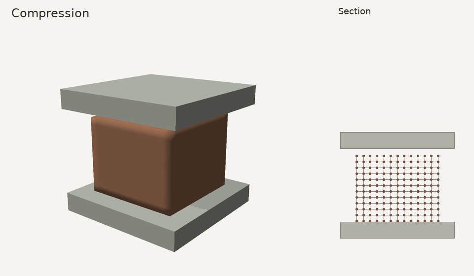
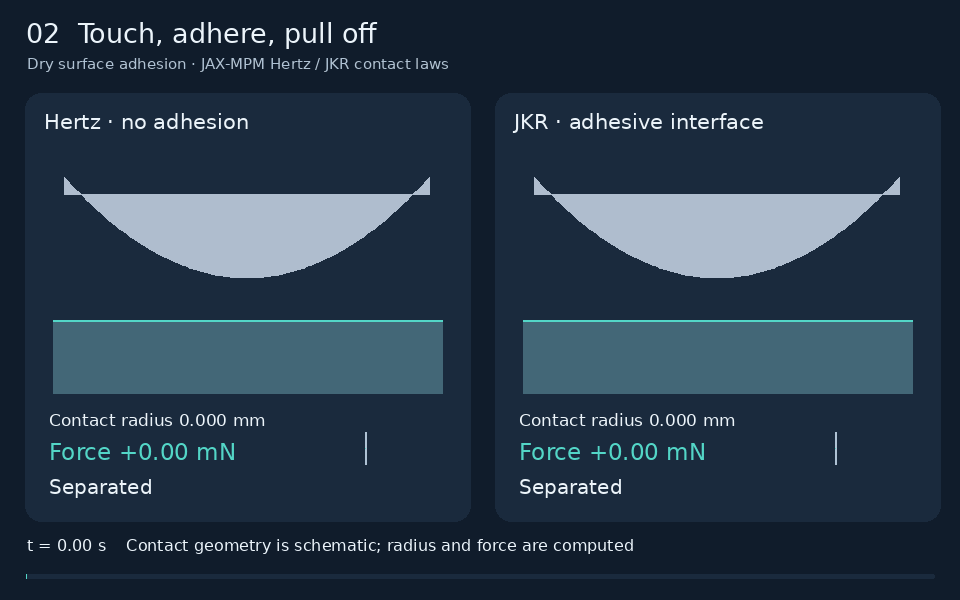
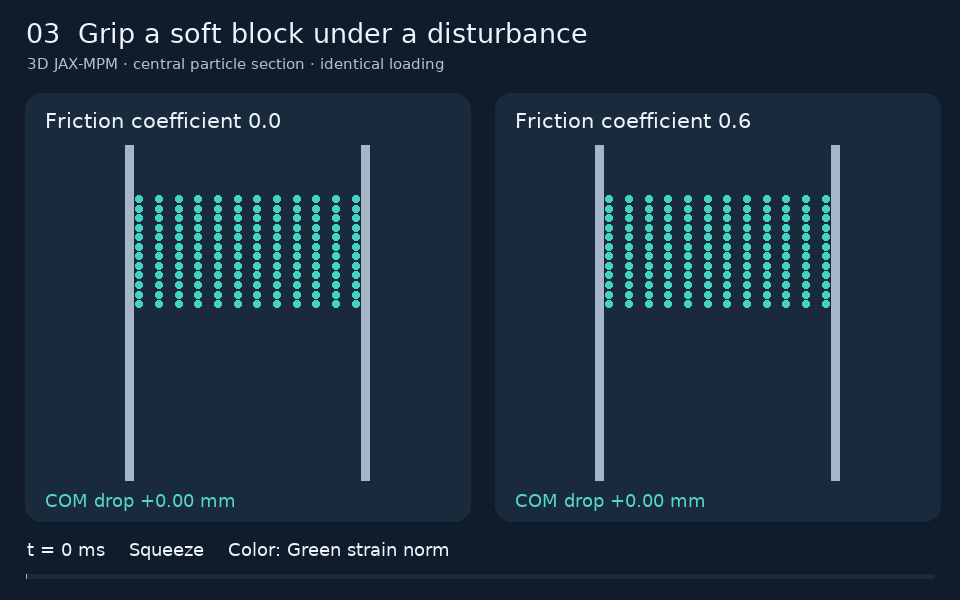
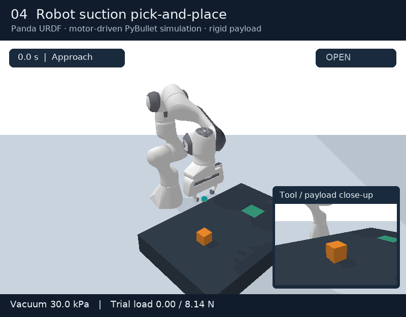
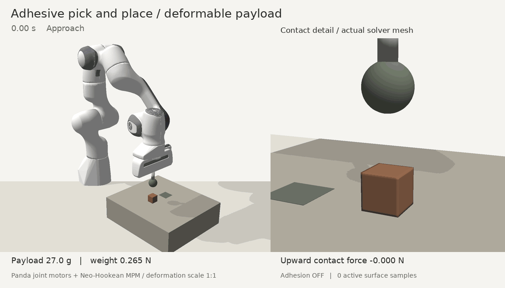
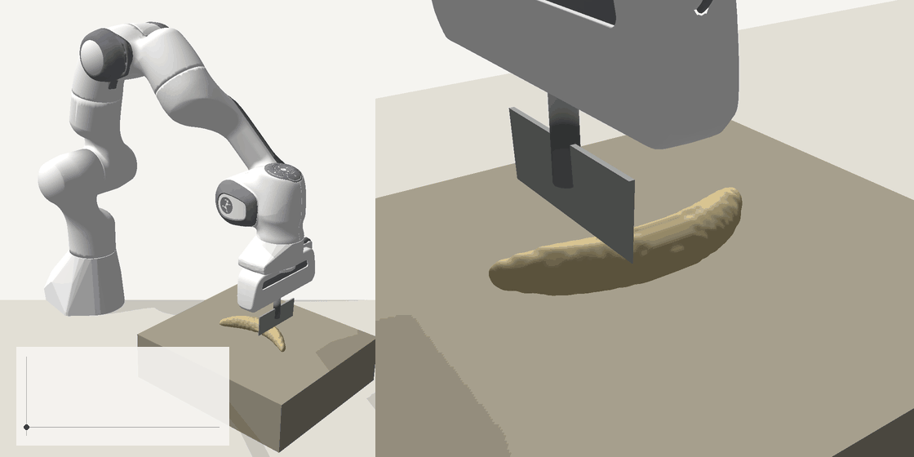
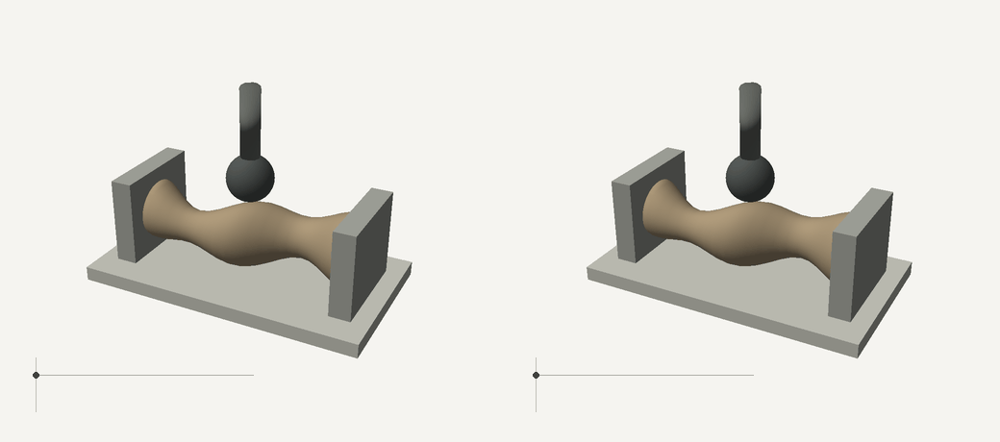

# SoftGripLab

Contact and material mechanics for robotic grasping, adhesion, and cutting.

[中文](README.zh-CN.md) · [Run the demos](docs/ANIMATIONS.md) · [Models](docs/MODELS.md) · [Validation](docs/VALIDATION.md)

### Compression



### Adhesive contact



Without adhesion (left), with adhesion (right).

### Deformable grasping



### Robot pick and place



### Adhesive transport



[Accelerate upward to detach](docs/ADHESIVE_ROBOT.md). Release shown in slow motion.

### Continuous cutting



[Cutting model and reproduction](docs/CUTTING.md).

Animations replay solved material states and robot poses. Insets show recorded axial force over time.

### Run

```bash
python -m pip install '.[robot,test]'
python -m softgriplab fem-demo
python -m softgriplab robot-demo
python -m pytest -q
```

[Adhesion](docs/ADHESIVE_ROBOT.md) · [Cutting](docs/CUTTING.md) · [All commands](docs/ANIMATIONS.md)

### Material identification

**Complex-shape hyperelasticity and adhesion:**
[model, inverse method and reproduction](docs/SHAPE_IDENTIFICATION.md).



Left: reference. Right: identified parameters. Both are solved again on a dense mesh.

**Active contact identification:** probe an unknown adhesive specimen and
predict release. [Run and inspect the benchmark](docs/ACTIVE_IDENTIFICATION.md).


Axial reference model; synthetic observations. Policy comparisons are reported without assuming an active-policy advantage.

Fit relaxation parameters from force–displacement histories with SciPy:

```bash
python -m softgriplab demo --output outputs/demo
```

The bundled identification data are synthetic; the fruit model is uncalibrated.
Built on Bullet FEM, JAX-MPM, PeriPy and the Panda model. [Attribution](NOTICE) · [GPL-3.0](LICENSE).
