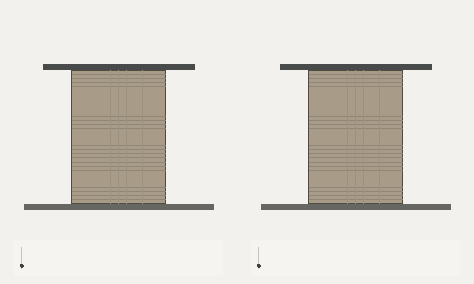
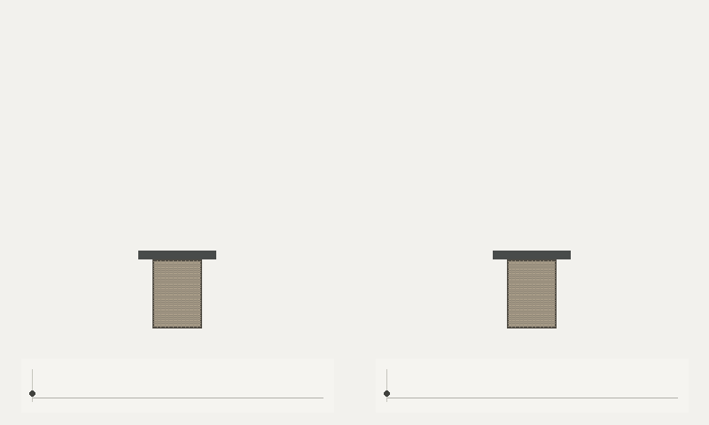

# Active identification of adhesive contact

An executable first benchmark for this question: can a short contact record
hide parameter differences that matter for subsequent release, and which
additional probe reduces that uncertainty?

```bash
python -m pip install '.[test]'
python -m softgriplab active-identification
python -m pytest tests/test_active_contact.py -q
```

The default run uses a CPU and the existing NumPy/SciPy/Pillow dependencies.
It writes animations, solved trajectories, observations, candidate predictions,
posterior weights, trial metrics and integration checks to
`outputs/active_identification`. No optional robot or GPU backend is required.

For a larger finite candidate set:

```bash
python -m softgriplab active-identification --hypotheses 2048 --trials 24 --rounds 2 --output outputs/active_2048
```

`--hypotheses` must be a power of two. `--seed` controls the scrambled Sobol
candidate bank, off-grid synthetic materials, observations and acquisition
sampling. `--no-render` skips GIFs. Increasing the bank does not guarantee
posterior convergence or remove model error.

## Demonstration

Two candidate materials selected using the initial noisy observation:



Their predictions for the same upward acceleration:



These are replays of an **axial reduced model**, with force–time insets.
Displacements are drawn at their solved scale. The fine surface lines interpolate
the assumed uniform axial strain; they are not additional finite elements.
The comparison is between two predicted materials, not two physical experiments.
The release GIF shows the first 90 ms in slow motion; the full trajectory is
retained in the NPZ file.

## Mechanical model

The specimen is a standard linear solid, with equilibrium modulus `E_inf`,
Maxwell branch modulus `E_branch` and relaxation time `tau`. Its two endpoints
carry known lumped masses. Let `x_b` and `x_t` be upward displacement of the
bottom and top, `b = x_t - x_b` its extension, and `z` its internal relaxed
extension. For length `L` and cross-sectional area `A`:

```text
z_dot = (b - z) / tau
F_bulk = A/L * (E_inf*b + E_branch*(b-z))
gap = tool_displacement - x_t
m_top * x_t_ddot = F_interface(gap) - F_bulk - m_top*g
m_bottom * x_b_ddot = F_bulk - m_bottom*g
```

During probing the bottom is clamped and gravity is omitted. During release
both endpoint equations are integrated, starting in exact relaxed equilibrium
under gravity. The tool accelerates upward with a raised-cosine pulse, then
continues at constant velocity. **Adhesion stays enabled throughout.**

The tensile interface force rises linearly to a peak at a known gap, then
decreases linearly to zero at a fixed separation cutoff. Its integral is `A*W`,
where `W` is the inferred work of adhesion. Negative gap gives compressive
penalty contact. This reversible potential has no progressive damage or
interfacial rate dependence; dissipation here comes from the bulk SLS.
Recontact can restore attraction. There is no commanded detachment event.

The observed channels are contact force and a visible mid-height surface
marker's displacement. Internal stress and true material parameters are not
given to the policy. Geometry, masses and interface length scales are known.

## Inference and comparison

The four unknowns have independent log-uniform priors. A scrambled Sobol set
discretizes that prior. The likelihood uses independent Gaussian sensor noise.
Acquisition integrates hypothetical noisy observations from the current
posterior using common Monte Carlo draws across candidate actions.

| Policy | Next action |
|---|---|
| `task` | Largest expected reduction in release-outcome entropy over an acceleration grid |
| `information` | Largest expected reduction in finite-hypothesis entropy |
| `fixed` | Predeclared large slow/fast, then pull-off slow/fast sequence |
| `random` | Seeded random choice from the same library |

Each additional probe has the same duration and sampling budget. Policies
receive the same initial observation and the same noise realization whenever
they choose the same action at the same round. They can repeat an action.
All probes start with a rested intact specimen; they do not yet carry material
history from one probe into the next. Force exposure is not matched, and no
damage constraint is enforced.

Synthetic truth is sampled continuously, is not inserted into the bank, and
is integrated at half the inference time step. Its release labels are available
only to evaluation. Acquisition uses candidate-model labels. Reported Brier
scores measure predicted detachment probabilities against withheld outcomes;
smaller is better. The paired task-minus-fixed difference is negative when
task-directed probing performs better.

## What this version establishes

Reproduce the archived run:

```bash
python -m softgriplab active-identification --hypotheses 512 --trials 12 --rounds 2 --seed 7 --output outputs/active_archive
```

The [archived report](results/active_identification/report.json) includes the
actual comparison, an automatically located ambiguous parameter pair, effective
hypothesis counts and numerical checks. No policy is required to win.

In the archived 12-material, two-probe run, the mean Brier score falls from
0.0266 initially to 0.0147 for both task-directed and fixed multirate probing.
Random probing reaches 0.0097 in this run. All policies have degenerate finite
posteriors in all 12 final trials. These results provide **no evidence of an
active-policy advantage**; the discretized posterior needs improvement first.

The illustrated pair is selected to maximize disagreement within a bounded
initial-response difference (0.25 noise-scaled RMS), while both fit the initial
observation within 1.3 RMS noise units. It is an illustrative counterexample,
not a randomly selected pair or a performance metric. Task outcomes require
separation throughout the final 20 ms of the observation window.

Finite-bank inference can concentrate on one wrong candidate after a strong
probe. `finite_bank_degenerate` flags an effective count below five. Low
posterior entropy in such a case does **not** establish low physical uncertainty.
Continuous posterior refinement and calibration across seeds are necessary
before treating these probabilities as reliable.

Tests check adhesion work, force signs, static suspension, acceleration-driven
release, work/energy/dissipation balance and agreement between explicit RK4
and SciPy's implicit adaptive Radau solver. The report also checks a halved
time step. Radau is an independent integration method for the **same equations**;
it is not independent constitutive-model validation.

This version has no 3D continuum, robot controller, unknown geometry, interface
damage, real measurements or model-mismatch experiment. It establishes a
reproducible method-development baseline, not a publication result or proof
of novelty. Next work should address posterior collapse, then independent
continuum/model-mismatch validation before adding robot presentation.

## Files

- `report.json`: assumptions, settings, aggregate results and integration checks.
- `metrics.csv`: every trial, policy and probe count, including the initial state.
- `benchmark.npz`: candidate/truth parameters, predictions, observations, task
  labels, chosen actions, posterior weights and release probabilities.
- `ambiguity_*.npz`: solved traces for the initially plausible parameter pair.
- `initial_probe.npz`, `probe_*.npz`: solved first-trial material states.
- `*.gif`: replays of those traces with recorded axial force.

All quantities use SI units. The archived configuration and source hashes are
in the report. The prototype reuses the repository's geometry validation,
SciPy integration/statistics, and force-inset renderer; it does not introduce
another general-purpose physics engine.
