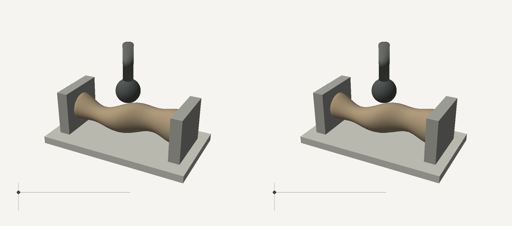

# Material identification when surface geometry is unknown



Left: reference. Right: reconstructed geometry and identified parameters.
Both panels replay independently solved dense FEM states, with measured tool
reactions in the insets. No displacement scaling or mesh interpolation is used.

This extension starts from an unordered, noisy partial point cloud. It estimates
the reference surface, builds a volume mesh, and uses the existing hyperelastic
and adhesive FEM model to identify shear modulus and adhesion work.

The implemented method is **two-stage**: reconstruct geometry, then fit material
parameters conditional on that geometry. It does not yet jointly update geometry
with contact forces or propagate geometric uncertainty into material intervals.

## Run

```bash
python -m pip install '.[shape,test]'
python -m softgriplab unknown-surface-identification
```

The benchmark builds a separate response library for each candidate geometry.
It then generates independent, off-grid material observations by direct FEM,
fits paired noisy force histories, and solves a dense reference/reconstruction
comparison for animation. Results and intermediate solves are cached under the
chosen output directory. `--no-dense --no-render` skips the dense replay.

For an external scan, supply a CSV with a header `x_m,y_m,z_m` and registered
coordinates in metres:

```bash
python -m softgriplab reconstruct-surface scan.csv --output outputs/scan
```

This command exports the estimated surface and volume mesh (`specimen.obj`,
`specimen.vtk`), coefficients and diagnostics. It does not identify a real
material from a scan alone; measured contact forces are also required. The
current material-identification command is a controlled synthetic benchmark.

## Explicit shape prior

The current object is solid and has elliptical cross-sections along a known
registered axis. End planes are fixed at x = -30 and +30 mm. Smooth profiles
describe the two cross-section centres and two positive radii. Their values
are estimated from xyz points; there are no scan-to-mesh correspondences.

[SciPy cubic splines](https://docs.scipy.org/doc/scipy/reference/generated/scipy.interpolate.CubicSpline.html)
represent these profiles, and
[bounded robust least squares](https://docs.scipy.org/doc/scipy/reference/generated/scipy.optimize.least_squares.html)
fits first-order cross-section distance residuals. A weak curvature
penalty regularizes axial variation. A reference mesh is then mapped into the
estimated geometry. Tetrahedra must have positive volume. The constitutive law,
contact potential, Newton solve and dimensional material reduction are reused
from [the existing 3D benchmark](SHAPE_IDENTIFICATION.md).

When a load increment fails to converge, the new benchmark retries it with
recursive load bisection. Every inserted state is solved to the original
equilibrium tolerance; observation poses remain unchanged. Subdivision counts
are retained in the library checks, and unsuccessful retries still raise an
error. This is numerical continuation, not deformation interpolation.
Library `checks` columns are minimum deformation determinant, maximum free-DOF
equilibrium residual, and the number of load bisections. A recovered high-adhesion
cycle is archived separately and its saved states are independently audited.

The scan samples 360 points on roughly 65% of the circumference, with 40 um
coordinate noise. Reconstruction uses 52 geometric coefficients and no neural
training. Completing the unseen lower arc depends on the elliptical prior.
It does **not** establish recovery of arbitrary hidden shapes, cavities,
branching geometry or the unloaded shape from an already-deformed scan.

## Controlled comparison

1. Reconstruct the surface from measured points only.
2. Plan three probe positions once from that reconstruction.
3. Keep those exact tool poses for the true, nominal and reconstructed models.
4. Build equal-budget, one-dimensional material-ratio libraries for the nominal
   and reconstructed geometries.
5. Generate true force histories with separate direct FEM solves at off-grid
   parameters, then fit both libraries to the same noisy observations.

The fixed nominal shape is a **geometry-mismatch ablation**, not a strong joint
shape/material optimizer. True geometry is available only to the synthetic
observation generator and error evaluation. The inverse and tool planner do
not see it. The geometric evaluation compares an independent dense surface,
and reports observed residuals and unseen-surface errors separately.

Only one geometry and three independent materials are evaluated. Repeated
noise draws do not increase the number of independent shapes or materials.
Additional shapes, scan angles, registration errors and out-of-family surfaces
are needed before making a generalization claim.

The archived run uses 12 paired force-noise repeats per material:

| Geometry used for inversion | Mean modulus error | Mean adhesion-work error |
|---|---:|---:|
| Fixed nominal shape | 15.40% | 17.14% |
| Reconstructed partial scan | 2.26% | 2.77% |

The reconstructed full-surface error is approximately 0.063 mm under this
shape prior; the unseen lower arc has 0.092 mm error. For the separately solved
dense comparison, whole-force-curve relative L2 error is 7.66%, mean absolute
force discrepancy is 2.04 mN, and position RMSE is 0.072 mm. This is one dense
case, not a mesh-convergence study. Whitened force residuals exceed the assumed
sensor noise, so the fitted parameters are not calibrated uncertainty estimates.

These results establish the effect of geometric mismatch in this
controlled example; they do not establish superiority over a strong joint
shape/material inverse method. See the [raw report](results/unknown_surface/report.json),
[paired fits](results/unknown_surface/metrics.csv), and binary-artifact
[checksums](results/unknown_surface/sha256.json).

## Next research step

The next method should retain geometric uncertainty during contact inversion.
A useful test is whether a small number of additional probes can distinguish
surface-height/curvature errors from changes in modulus and adhesion. Compare
fixed scanning followed by fitting against joint shape/material fitting and
uncertainty-guided probing at equal scan, contact and FEM budgets.

A small implicit surface or physics-constrained residual network could replace
the spline parameterization if it improves those comparisons. Any such network
should fit the current object and measured observations; a large pretrained
shape/material dataset is not part of this design. Neither neural fitting nor
an active-probing advantage is implemented or claimed here.
