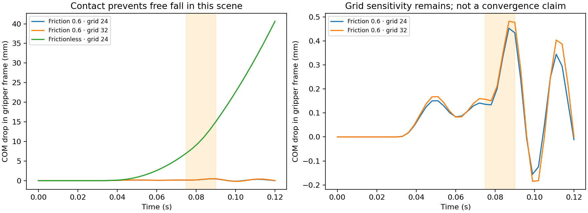

# Validation record — 2026-10-26

This release provides numerical verification and integration examples. There are
no physical experiments or real-robot success rates in this record.

## Material identification and reference grasp

Run `python -m softgriplab demo --output outputs/demo` with seed 7.
Inputs are two analytic ramp/hold traces with independent Gaussian force noise
(standard deviation 0.005 N), durations 4 s, ramp times 0.12 and 0.8 s.
The numerical forward model uses SciPy `lsim`; it is not used to generate truth.

| Parameter | Truth | Fitted | Relative error |
| --- | ---: | ---: | ---: |
| Equilibrium modulus | 35000 Pa | 34990.796 Pa | 0.0263% |
| Maxwell branch modulus | 65000 Pa | 64861.418 Pa | 0.2132% |
| Relaxation time | 0.6 s | 0.600197 s | 0.0328% |

The unseen 0.035 s ramp has relative force L2 error **0.0917%**. This confirms
recovery for the assumed model and synthetic loading; it does not validate real
rate-dependent material behavior. Against a deliberately different two-branch
material, error rises to **11.23%**. That probe is reported without refitting.
The weighted Jacobian condition number is 7.32.

| Strategy | Minimum physical force margin | Peak compression strain | Meets configured design constraints? |
| --- | ---: | ---: | --- |
| Fixed closure | -0.0643 N | 4.000% | No |
| Ideal force control | +0.1595 N | 5.332% | Yes |
| Identified fixed closure | +0.1283 N | 5.337% | Yes |

Physical margin uses m|g+a|; the planner uses an additional factor of 1.2.
The strain cap is 8%. The identified plan is evaluated using the true synthetic
material, not the fitted model. Its closure is 1.0674 mm. Ideal force control
also succeeds; no universal superiority claim is made.

Machine-readable inputs, policies and results are in [results/](results/).

## Three-dimensional backend

Public JAX-MPM reference commit:
`fd8ed2caa40a50d01992420660f68ae6ce0d084f`.
The source files needed by the exercised API were retrieved/compared against
that commit in an isolated verification snapshot. Their Git blob hashes are in
[backend_api.json](results/backend_api.json). No upstream source is committed
into SoftGripLab. The existing local solver checkout was not modified.

Executed on CPU using Python 3.12.13 and JAX `0.12.1.dev20261022`.
Fresh optional-dependency installation and hosted CI were not exercised locally;
the source/API compatibility was exercised with the existing JAX runtime.

```bash
python -m softgriplab mpm-grasp --grid 24 --frames 40 --gif --output outputs/mpm
python -m softgriplab mpm-grasp --grid 24 --frames 40 --friction 0 --output outputs/mpm_frictionless
python -m softgriplab mpm-grasp --grid 24 --frames 40 --friction 0 --dt-factor 0.5 --output outputs/mpm_frictionless_halfdt
python -m softgriplab mpm-grasp --grid 32 --frames 40 --output outputs/mpm_grid32
python tools/collect_validation.py
```

| Check | Result |
| --- | --- |
| Grid 24, friction 0.6 | 1728 particles; 1120 steps; frame-sampled min det(F) = 0.88347 |
| Grid 24, frictionless | Final COM drop 40.638278 mm |
| Independent free-motion integral | Final COM drop 40.638597 mm |
| Time-step reduction | Absolute drop error decreases from 0.3193 µm to 0.0828 µm |
| Frictional peak drop, grid 24 | 0.45315 mm |
| Frictional peak drop, grid 32 | 0.48202 mm |

The free-motion oracle integrates `(end_time-t) * acceleration(t)` independently
with SciPy quadrature. With zero jaw friction, horizontal squeeze must not alter
vertical center-of-mass momentum. Its error reduces with the smaller time step.
This check validates that part of the loading/integration interface, not all
contact or constitutive behavior.

The two frictional grid resolutions differ by about 6.4% in peak COM drop.
**Spatial convergence is not established.** The imposed jaw closure is smaller
than a grid cell, so geometric contact error matters. These coarse scenes
demonstrate backend integration and contact response; they are not calibrated
predictions of a physical gripper's retention limit.



## Automated checks

- Base Python 3.11 environment: 15 reference/CLI tests pass; the optional MPM
  test is skipped when JAX-MPM is absent.
- Python 3.12 with the pinned backend API: **16 tests passed**.
- Coverage includes analytic finite ramps, step relaxation, ideal creep,
  multirate noisy parameter recovery, held-out loading, short-record warnings,
  malformed input, two-contact force accounting, pulse impulse, infeasible plans,
  excessive creep, CSV CLI input and optional continuum momentum balance.

GitHub Actions definitions are included. Local success is not a claim that a
remote workflow has run or passed; consult the repository's Actions page.

The v0.1.0 wheel was built and installed into an isolated target directory.
The installed package's CLI reproduced the material fit from the committed CSVs.
